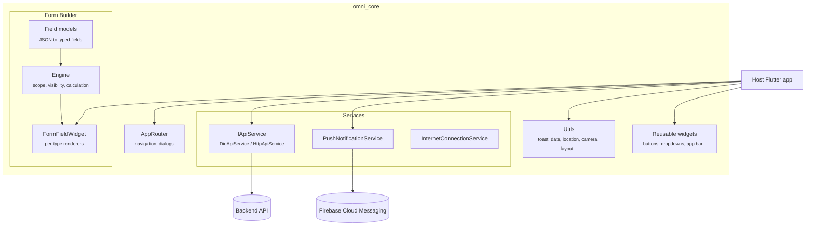
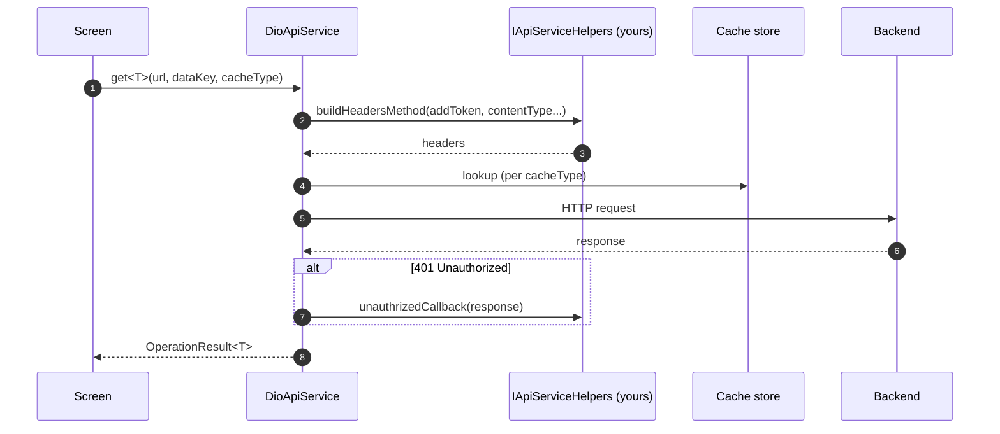
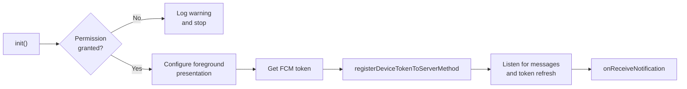
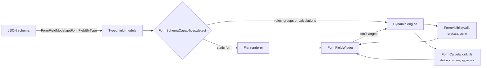
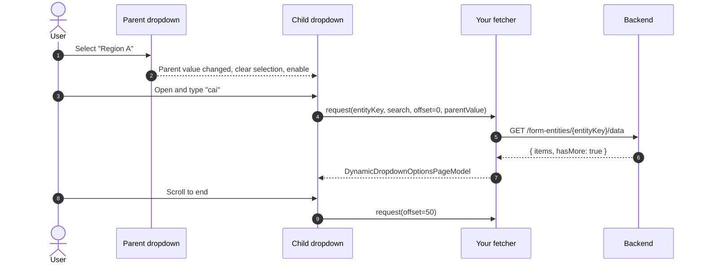

<div align="center">

# omni_core

**A production-ready Flutter foundation: networking, push notifications, device utilities, reusable UI, and a schema-driven dynamic form engine, all in one package.**

[](CHANGELOG.md)
[](https://dart.dev)
[](https://flutter.dev)
[](#requirements)
[](LICENSE)

[Features](#features) &nbsp;•&nbsp; [Installation](#installation) &nbsp;•&nbsp; [Quick start](#quick-start) &nbsp;•&nbsp; [Form Builder](#form-builder) &nbsp;•&nbsp; [API reference](#api-reference)

</div>

---

> [!NOTE]
> This package is primarily built for personal and internal projects, but you are welcome to use it in yours. The public API may evolve between minor versions; check the [changelog](CHANGELOG.md) before upgrading.

## Table of contents

- [Features](#features)
- [Architecture](#architecture)
- [Requirements](#requirements)
- [Installation](#installation)
- [Quick start](#quick-start)
- [Networking](#networking)
  - [Setting up `DioApiService`](#setting-up-dioapiservice)
  - [Making requests](#making-requests)
  - [Caching strategies](#caching-strategies)
  - [Request cancellation](#request-cancellation)
  - [`OperationResult<T>`](#operationresultt)
- [Push notifications](#push-notifications)
- [Navigation](#navigation)
- [Form Builder](#form-builder)
  - [Supported field types](#supported-field-types)
  - [Rendering a form](#rendering-a-form)
  - [Dynamic dropdowns](#dynamic-dropdowns)
  - [Visibility rules](#visibility-rules)
  - [Calculated fields](#calculated-fields)
  - [Repeating groups](#repeating-groups)
- [Utilities](#utilities)
- [Widgets](#widgets)
- [API reference](#api-reference)
- [Project structure](#project-structure)
- [License](#license)

---

## Features

<table>
<tr>
<td width="50%" valign="top">

### Networking
- Unified `IApiService` contract with **Dio** and **http** implementations
- Typed results through `OperationResult<T>`
- Five per-request **caching strategies** backed by Hive
- Per-page **request cancellation**
- Single, multiple and complex **multipart uploads**, plus file downloads
- Granular, overridable **error handling** for every Dio failure type

</td>
<td width="50%" valign="top">

### Form Builder
- **26 field types** parsed straight from a JSON schema
- **Dynamic dropdowns** with server-side search, paging and parent/child dependencies
- Declarative **visibility rules** with automatic pruning of hidden values
- **Derived and computed** fields (lookup, formula, aggregate)
- **Repeating groups** with isolated per-item scopes

</td>
</tr>
<tr>
<td width="50%" valign="top">

### Platform services
- **Firebase Cloud Messaging** lifecycle (permissions, token registration, listeners)
- App icon **badge** management
- **Location**, **camera** and permission flows with user-facing dialogs
- Reverse **geocoding** with provider fallback
- Device ID, device info and app version helpers
- Internet connectivity monitoring

</td>
<td width="50%" valign="top">

### UI toolkit
- Navigator-key based **router** with transitions and confirmation dialogs
- Toasts, modal sheets and locale-aware **date / range pickers**
- Custom **dropdowns** (single, multi, dynamic)
- Buttons, app bar, search box, placeholders, hero popup, language switcher
- Responsive **layout helpers** (mobile / tablet / desktop)

</td>
</tr>
</table>

---

## Architecture

The package ships as a single library (`package:omni_core/omni_core.dart`). Everything the host app needs is exported from that one import.



**Design principles**

| Principle | How it shows up |
| --- | --- |
| Host owns the infrastructure | The package never hardcodes your base URL, auth, or token storage. You provide them through `IApiServiceHelpers`, callbacks, and fetchers. |
| Typed results, not exceptions | Network calls return `OperationResult<T>` rather than throwing, so every call site handles success and failure explicitly. |
| Schema-driven UI | Forms are described by JSON and rendered by type; new forms need no new widget code. |
| Fail safe | Malformed visibility rules show the field rather than hide data; badge updates never crash the app. |

---

## Requirements

| Requirement | Version |
| --- | --- |
| Dart SDK | `^3.8.1` |
| Flutter | `>= 1.17.0` (a recent stable channel is recommended) |
| Platforms | Android, iOS |
| Firebase | Required only if you use `PushNotificationService` |

---

## Installation

Add the package to your `pubspec.yaml`. Pinning to a tag or commit is recommended so upgrades are deliberate:

```yaml
dependencies:
  omni_core:
    git:
      url: https://github.com/ahmedabdelrahmanalghwalbi/omni_core.git
      ref: master # or a specific tag / commit
```

Then fetch dependencies:

```bash
flutter pub get
```

And import the library:

```dart
import 'package:omni_core/omni_core.dart';
```

<details>
<summary><strong>Platform setup checklist</strong></summary>

<br/>

Several features wrap platform plugins that need native configuration in the host app:

| Feature | Plugin | Host setup |
| --- | --- | --- |
| Push notifications | `firebase_messaging` | Add `google-services.json` / `GoogleService-Info.plist`, enable Push Notifications and Background Modes on iOS |
| Location | `geolocator`, `geocoding` | Location usage descriptions in `Info.plist`, location permissions in `AndroidManifest.xml` |
| Camera / photos | `image_picker`, `permission_handler` | `NSCameraUsageDescription`, `NSPhotoLibraryUsageDescription` |
| File uploads | `file_picker` | Follow the plugin's platform notes |
| Localization | `easy_localization` | Wrap the app in `EasyLocalization` if you use locale-aware widgets |

</details>

---

## Quick start

Wire the package's `navigatorKey` into your `MaterialApp`. Toasts, modal sheets, dialogs and navigation all resolve their context through it.

```dart
import 'package:flutter/material.dart';
import 'package:omni_core/omni_core.dart';

void main() => runApp(const MyApp());

class MyApp extends StatelessWidget {
  const MyApp({super.key});

  @override
  Widget build(BuildContext context) {
    return MaterialApp(
      navigatorKey: AppRouter.navigatorKey,
      navigatorObservers: [AppRouter.routeObserver],
      home: const HomePage(),
    );
  }
}
```

Anywhere in the app:

```dart
AppRouter.navigateTo(() => const DetailsPage(), animationType: AnimationTypes.slide);
ToastUtils.showSuccess('Saved successfully');
```

---

## Networking

### Setting up `DioApiService`

`DioApiService` delegates everything app-specific (headers, tokens, error mapping) to an `IApiServiceHelpers` implementation that you own.



```dart
final apiService = DioApiService(
  dio: Dio(),
  apiServiceHelper: MyApiServiceHelpers(), // implements IApiServiceHelpers
  cancelTokenManager: DioApiCancelTokenManagerService(),
  connectionTimeout: 30, // seconds
  receiveTimeout: 30,
  sendTimeout: 60,
  enableCache: true,
);
```

<details>
<summary><strong>Implementing <code>IApiServiceHelpers</code></strong></summary>

<br/>

Your implementation decides how headers are built and how each failure category is turned into an `OperationResult`. Load tokens from your secure storage here; never hardcode them.

```dart
class MyApiServiceHelpers implements IApiServiceHelpers {
  @override
  void Function(dynamic response)? unauthrizedCallback = (_) {
    // e.g. clear the session and route to login
  };

  @override
  Future<Map<String, String>> buildHeadersMethod({
    Map<String, dynamic>? additionalHeaders,
    bool? addToken = true,
    bool? addSessionCookie = false,
    bool isBasicAuth = false,
    String? basicUsername,
    String? basicPassword,
    RequestContentType contentType = RequestContentType.json,
    RequestAcceptanceType acceptanceType = RequestAcceptanceType.json,
  }) async {
    final token = await secureStorage.read(key: 'access_token');
    return {
      'Accept': acceptanceType == RequestAcceptanceType.json ? 'application/json' : '*/*',
      'Content-Type': contentType == RequestContentType.json
          ? 'application/json'
          : 'application/x-www-form-urlencoded',
      if (addToken == true && token != null) 'Authorization': 'Bearer $token',
      ...?additionalHeaders?.map((k, v) => MapEntry(k, '$v')),
    };
  }

  @override
  OperationResult<T> handleDIOBadResponse<T>({
    required DioException error,
    required String endpoint,
    required StackTrace stackTrace,
  }) => OperationResult<T>(
        statusCode: error.response?.statusCode ?? 500,
        message: 'Something went wrong. Please try again.',
      );

  // ...implement the remaining handle* methods the same way.
}
```

| Handler | Triggered when |
| --- | --- |
| `handleDIOConnectionError` | No internet, DNS failure, server unreachable |
| `handleDIOConnectionTimeout` | Server does not respond within `connectTimeout` |
| `handleDIOSendTimeout` | Upload / request body times out |
| `handleDIOReceiveTimeout` | Download / response body times out |
| `handleDIOBadCertificate` | TLS certificate validation fails |
| `handleDIOBadResponse` | Server responds with a 4xx / 5xx status |
| `handleDIOCancelledRequest` | Request cancelled (e.g. user left the page) |
| `handleDIOUnknownError` | Parsing, casting, or other unexpected errors |
| `handleDIOApiCallsErrorsMethod` | Any non-Dio exception during a call |
| `handleHTTP*` | Equivalents for `HttpApiService` |

</details>

### Making requests

Every method takes a `currentPageKeyForCancelTokens` (used to cancel in-flight requests when a page is disposed) and a `dataKey`.

```dart
final result = await apiService.get<Map<String, dynamic>>(
  '$baseUrl/profile',
  currentPageKeyForCancelTokens: 'ProfilePage',
  dataKey: 'data',
  addToken: true,
  cacheType: RequestCacheTypes.refreshForceCache,
);

if (result.success) {
  final profile = Profile.fromJson(result.data!);
} else {
  ToastUtils.showError(result.message ?? 'Unable to load profile');
}
```

| Method | Purpose |
| --- | --- |
| `get` | Read data, with optional caching and image pre-caching |
| `post` / `put` / `patch` / `delete` | Standard JSON or URL-encoded writes |
| `postWithFormDataSingleFile` | Multipart upload of one `File` |
| `postWithFormDataMultipleFiles` | Multipart upload of a `List<File>` under one field |
| `postWithFormDataComplexFiles` | Multipart upload of a nested map of fields and files |
| `putWithFormDataSingleFile` / `putWithFormDataMultipleFiles` / `patchWithFormDataMultipleFiles` | Multipart updates |
| `downloadFile` | Stream a file to `savePath` with progress |
| `clearCache` | Wipe cached responses (call on logout) |

### Caching strategies

Caching is honored by `DioApiService` when constructed with `enableCache: true`. The strategy is chosen per request and never mutates global state.

| `RequestCacheTypes` | Reads cache | Hits network | Writes cache | Typical use |
| --- | :---: | :---: | :---: | --- |
| `request` | Depends on headers | Yes | Yes | Standard HTTP caching |
| `forceCache` | Yes | No | No | Full offline mode |
| `refresh` | No | Yes | Yes | Pull-to-refresh |
| `noCache` | No | Yes | No | Login, OTP, sensitive data |
| `refreshForceCache` **(default)** | On failure | Yes | Yes | Fresh online, fallback offline |

> [!IMPORTANT]
> Call `apiService.clearCache()` on logout so a new user on the same device never sees the previous user's cached responses.

### Request cancellation

```dart
@override
void dispose() {
  apiService.cancelCurrentPageRequests(currentPageKeyForCancelTokens: 'ProfilePage');
  super.dispose();
}
```

Use `cancelAllRequests()` to abort everything, for example on logout.

### `OperationResult<T>`

| Field | Type | Description |
| --- | --- | --- |
| `success` | `bool` | `true` for 2xx responses |
| `statusCode` | `int` | HTTP status code |
| `bodyStatusCode` | `int?` | Status code reported inside the response body |
| `data` | `T?` | Parsed payload |
| `message` / `messageAr` / `messageUr` | `String?` | Localized server messages |
| `hasNoInternetConnection` | `bool?` | Set when the device was offline |
| `status` | `ApiStatus?` | Optional structured status (`code`, `message`, `token`) |
| `responseHeaders` | `Map<String, dynamic>?` | Raw response headers |

---

## Push notifications

`PushNotificationService` handles the Firebase Cloud Messaging lifecycle. You supply three callbacks; the service handles the rest.



```dart
final pushService = PushNotificationService(
  registerDeviceTokenToServerMethod: ({required notificationDeviceToken}) async {
    await myApi.registerDevice(notificationDeviceToken);
  },
  unregisterDeviceTokenToServerMethod: () async => myApi.unregisterDevice(),
  onReceiveNotification: ({required message}) async {
    // Route the user or refresh data based on message?.data
  },
);

await Firebase.initializeApp();
await pushService.init();
```

| Method | Description |
| --- | --- |
| `init()` | Request permission, configure presentation, register the token, start listeners |
| `unRegisterNotificaitonDeviceToken()` | Remove the token from your backend and FCM (call on logout) |
| `getNotificationPermissionStatus()` | Whether notifications are currently authorized |

Badge control is available through `NotificationBadgeUtils`:

```dart
await NotificationBadgeUtils.setNotificationBadgeCount(3);
await NotificationBadgeUtils.clearNotificationBadge(isIOSOnly: true);
```

---

## Navigation

`AppRouter` is a static, context-free router built on `AppRouter.navigatorKey`.

```dart
AppRouter.navigateTo(() => const HomePage(), replaceAll: true, animationType: AnimationTypes.fade);
AppRouter.goBack(result: selectedItem);
AppRouter.goBackUntil(routeName: '/');

final confirmed = await AppRouter.showConfirmMessageWithLogo(
  // ...title, message, icon
  confirmText: 'Delete',
  denyText: 'Cancel',
);
```

| API | Description |
| --- | --- |
| `navigateTo(creator, replace, replaceAll, animationType)` | Push, replace, or reset the stack with `none`, `fade` or `slide` transitions |
| `goBack<T>({result})` / `goBackUntil(routeName)` | Pop safely |
| `showConfirmMessageWithLogo(...)` | Confirmation dialog with an SVG or icon header; returns `bool` |
| `showConfirmDialogWithOptionalTextField(...)` | Confirmation dialog that can collect a text input |
| `subscribeRouteObserver` / `unsubscribeRouteObserver` | Hook a `RouteAware` into `AppRouter.routeObserver` |

---

## Form Builder

The Form Builder turns a JSON form definition into a fully interactive Flutter form. Each field is parsed into a typed model, the engine resolves visibility and calculations within the correct scope, and `FormFieldWidget` renders it.



`FormSchemaCapabilities.detect(fields).usesDynamicEngine` tells you whether a form needs the scope-aware engine. Forms that use none of the dynamic features render exactly as before, with no configuration.

### Supported field types

The field type comes from the `name` property of each field in the schema. Several spellings are accepted (for example `radio_group`, `radio-group`, `radiogroup`).

<table>
<tr><th>Category</th><th>Type</th><th>Schema <code>name</code></th><th>Model</th></tr>

<tr><td rowspan="16"><strong>Input</strong></td>
<td>Text</td><td><code>input</code></td><td><code>TextFormFieldModel</code></td></tr>
<tr><td>Text area</td><td><code>text_area</code></td><td><code>TextAreaFormFieldModel</code></td></tr>
<tr><td>Number</td><td><code>numberinput</code></td><td><code>NumberFormFieldModel</code></td></tr>
<tr><td>Checkbox</td><td><code>checkbox</code></td><td><code>CheckboxFormFieldModel</code></td></tr>
<tr><td>Toggle</td><td><code>toggle</code></td><td><code>ToggleFormFieldModel</code></td></tr>
<tr><td>Radio group</td><td><code>radio_group</code></td><td><code>RadioGroupFormFieldModel</code></td></tr>
<tr><td>Dropdown</td><td><code>dropdown</code></td><td><code>DropdownFormFieldModel</code></td></tr>
<tr><td>Dynamic dropdown</td><td><code>dynamic_dropdown</code> or <code>dropdown</code> with <code>entityConfig</code></td><td><code>DynamicDropdownFormFieldModel</code></td></tr>
<tr><td>Multi select</td><td><code>multi_select</code></td><td><code>MultiSelectFormFieldModel</code></td></tr>
<tr><td>Dynamic multi select</td><td><code>dynamic_multi_select</code> or <code>multi_select</code> with <code>entityConfig</code></td><td><code>DynamicMultiSelectFormFieldModel</code></td></tr>
<tr><td>Date</td><td><code>datepicker</code></td><td><code>DatePickerFormFieldModel</code></td></tr>
<tr><td>Date and time</td><td><code>datetime</code></td><td><code>DateTimePickerFormFieldModel</code></td></tr>
<tr><td>File uploader</td><td><code>uploader</code></td><td><code>FileUploaderFormFieldModel</code></td></tr>
<tr><td>Take photo</td><td><code>camera</code></td><td><code>TakePhotoFormFieldModel</code></td></tr>
<tr><td>Multiple photos</td><td><code>FormFieldType.multipleTakePhotos</code> (no schema alias yet)</td><td><code>MultipleTakePhotosFormFieldModel</code></td></tr>
<tr><td>Signature</td><td><code>signature</code></td><td><code>SignatureFormFieldModel</code></td></tr>

<tr><td rowspan="2"><strong>Calculated</strong></td>
<td>Derived value</td><td><code>derived_value</code></td><td><code>DerivedValueFormFieldModel</code></td></tr>
<tr><td>Computed value</td><td><code>computed_value</code></td><td><code>ComputedValueFormFieldModel</code></td></tr>

<tr><td rowspan="6"><strong>Static</strong></td>
<td>Header</td><td><code>header</code></td><td><code>HeaderFormFieldModel</code></td></tr>
<tr><td>Label</td><td><code>label</code></td><td><code>LabelFormFieldModel</code></td></tr>
<tr><td>Image</td><td><code>image</code></td><td><code>ImageFormFieldModel</code></td></tr>
<tr><td>Link</td><td><code>link</code></td><td><code>LinkFormFieldModel</code></td></tr>
<tr><td>Progress circle</td><td><code>progress_circle</code></td><td><code>ProgressCircleFormFieldModel</code></td></tr>
<tr><td>Progress line</td><td><code>progress_line</code></td><td><code>ProgressLineFormFieldModel</code></td></tr>

<tr><td rowspan="2"><strong>Structure</strong></td>
<td>Container</td><td><code>container</code></td><td><code>ContainerFormFieldModel</code></td></tr>
<tr><td>Repeating group</td><td><code>repeating_group</code></td><td><code>RepeatingGroupFormFieldModel</code></td></tr>
</table>

Every field shares these base properties from `FormFieldModel`:

```json
{
  "key": "customer_name",
  "name": "input",
  "title": "Customer name",
  "placeholder": "Enter the customer name",
  "required": { "value": true, "validationMessage": "Customer name is required" },
  "requiredWhenVisible": false,
  "visibilityRules": null,
  "css": {}
}
```

### Rendering a form

```dart
final fields = (schema['fields'] as List)
    .map((json) => FormFieldModel.getFormFieldByType(json))
    .toList();

final scope = FormFieldScopeUtils.flatten(fields);

ListView(
  children: FormVisibilityUtils.visibleFields(fields, scope)
      .map((field) => FormFieldWidget(
            fieldModel: field,
            scopeFields: scope,
            primaryColor: Theme.of(context).primaryColor,
            locale: context.locale,
            spacing: 16,
            innerSpacing: 8,
            fieldRadius: 12,
            fieldFillColor: Colors.white,
            fieldBorderSize: 1,
            fieldBorderColor: Colors.grey.shade300,
            fieldHeight: 52,
            fieldIconSize: 20,
            fieldLabelTextStyle: textTheme.titleSmall!,
            fieldTextStyle: textTheme.bodyMedium!,
            fieldHintStyle: textTheme.bodyMedium!.copyWith(color: Colors.grey),
            mainAxisAlignment: MainAxisAlignment.start,
            crossAxisAlignment: CrossAxisAlignment.start,
            onChanged: (key, value) {
              FormVisibilityUtils.pruneForm(fields);
              FormCalculationUtils.recalculateForm(fields);
              setState(() {});
            },
          ))
      .toList(),
);
```

`FormFieldWidget` also exposes per-type customization, including labels for date pickers, photo sources, signature pads, uploaders and repeating groups, so every visible string can be localized by the host.

### Dynamic dropdowns

Dropdowns arriving with `data.queryKey: "dynamic"` and a `data.entityConfig` are parsed as `DynamicDropdownFormFieldModel`. Their options come from the backend entity endpoint (`GET /api/v1/form-entities/{entityKey}/data`) rather than the form definition.

The package does **not** perform the HTTP call. The host supplies a `DynamicDropdownOptionsFetcher`, so authentication and base URL stay under the app's control:

```dart
FormFieldWidget(
  // ...existing parameters
  dynamicDropdownOptionsFetcher: (request) async {
    final response = await apiClient.get(
      '/api/v1/form-entities/${request.entityKey}/data',
      queryParameters: request.toQueryParameters(),
    );
    return DynamicDropdownOptionsPageModel.fromJson(response.data);
  },
  // Required for dependent dropdowns: return the current value of the parent field.
  dynamicDropdownParentValueResolver: (parentFieldKey) => formValues[parentFieldKey],
  dynamicDropdownSearchHintText: 'Search',
  dynamicDropdownRetryButtonText: 'Retry',
  dynamicDropdownNoResultsText: 'No results',
  dynamicDropdownLoadFailedText: 'Failed to load options',
)
```



**Behavior**

- Options load when the field opens, with debounced server-side search and infinite-scroll pagination driven by `hasMore`.
- The stored value (and the one emitted through `onChanged`) is `{ "id": ..., "displayValue": ..., "entityKey": ... }`, the shape the submissions endpoint expects.
- A dropdown whose `entityConfig.dependsOn` is set stays disabled until its parent has a value, and is cleared whenever the parent changes. The parent id is sent as `parentValue` along with `parentEntityKey`.
- If the fetcher throws or returns `null`, the field shows a retry state. Without a fetcher, dynamic dropdowns are skipped with a warning log.

| `DynamicDropdownOptionsRequestModel` | Description |
| --- | --- |
| `entityKey` | Entity to query |
| `displayField` | Property to show as the option label |
| `limit` / `offset` | Paging (default `50` / `0`) |
| `search` | Current search text |
| `parentEntityKey` / `parentValue` | Parent entity and its selected id, for dependent dropdowns |
| `includeProperties` | Extra properties returned with every option, so derived fields can read them offline |

### Visibility rules

Any field can declare when it should be shown. Conditions always refer to **sibling fields in the same scope**: top-level fields read top-level values, and fields inside a repeating-group item read only that item.

```json
{
  "key": "rejection_reason",
  "name": "text_area",
  "title": "Reason for rejection",
  "requiredWhenVisible": true,
  "visibilityRules": {
    "operator": "AND",
    "conditions": [
      { "field": "decision", "operator": "equals", "value": "rejected" },
      { "field": "category", "operator": "in", "value": ["safety", "quality"] }
    ]
  }
}
```

| Operator | Aliases | Meaning |
| --- | --- | --- |
| `equals` | `eq`, `==` | Value matches |
| `notEquals` | `neq`, `!=` | Value differs |
| `in` | | Value is one of the list |
| `notIn` | `not_in` | Value is none of the list |
| `exists` | | Field holds a meaningful answer |
| `notExists` | `not_exists` | Field is unanswered |

- **Combinators:** the rule-level `operator` is `AND` (`&&`, the default) or `OR` (`||`).
- **Shorthand and nesting:** a single `showWhen` condition is accepted, and an entry of `conditions` that has its own `conditions` is treated as a nested group.
- **Type tolerant:** `49`, `49.0` and `"49"` compare as equal.
- **Meaningful values:** `null`, `false`, `0`, blank text and empty lists or groups count as unanswered for `exists`.
- **Safe by default:** an incomplete rule, or one pointing outside the scope, keeps the field visible so no data is hidden by mistake.
- **Pruning:** `FormVisibilityUtils.pruneForm(fields)` clears the values of hidden fields, following chains such as *action → reason → reason details* until nothing else changes.
- A hidden field is never required, whatever `required` or `requiredWhenVisible` says.

### Calculated fields

Calculated fields are read-only and resolved by `FormCalculationUtils`. They give the user immediate feedback; the server recomputes them on submission and its result is authoritative.

| Kind | Config key | How the value is obtained |
| --- | --- | --- |
| Derived, **lookup** | `derivedConfig.sourceField` + `sourceProperty` | Reads a property of the entity selected in another field, optionally combined with a second field through `calculation` (for example unit price × quantity) |
| Derived, **formula** | `derivedConfig.operands` + `operator` | Combines other fields in the same scope |
| Derived, **aggregate** | `derivedConfig.groupField` + `childField` + `operator` | Reduces one child field across every item of a repeating group |
| Computed | `computedConfig.operands` + `operator` | Combines fields in the field's own scope |

**Operators:** `add`, `subtract`, `multiply`, `divide`, `sum`, `product`, `min`, `max`, `avg` (with aliases such as `+`, `-`, `*`, `/`, `average`, `mean`).

Chains like `subtotal → additional → total` settle in a single `recalculateForm` call, and aggregates and top-level formulas are resolved together so a formula can read an aggregate (for example the total of every item plus a call-out fee). A cycle in the definition is detected and logged rather than looping forever.

### Repeating groups

A repeating group lets the user add, edit and remove items built from the template in its `fields` array. Each item owns its own field instances, so values, dependent dropdown options and visibility rules are independent between items.

```json
{
  "key": "materials",
  "name": "repeating_group",
  "title": "Materials used",
  "groupConfig": {
    "itemLabel": "Material",
    "addItemLabel": "Add material",
    "minItems": 1,
    "maxItems": 10,
    "allowDelete": true,
    "allowEdit": true,
    "collapsibleItems": true,
    "collapseCompletedItems": false
  },
  "fields": [
    { "key": "material", "name": "dropdown", "title": "Material" },
    { "key": "quantity", "name": "numberinput", "title": "Quantity" }
  ]
}
```

The host controls item lifecycle through these `FormFieldWidget` callbacks:

| Callback | Purpose |
| --- | --- |
| `onRepeatingGroupAddItem(groupKey)` | Append a new item |
| `onRepeatingGroupDeleteItem(groupKey, index)` | Remove an item (confirm first if it holds data) |
| `onRepeatingGroupItemExpandedChanged(groupKey, index, expanded)` | Track collapse state |
| `onRepeatingGroupItemFieldChanged(groupKey, index, fieldKey, value)` | Prune, recalculate and persist the item's scope |

---

## Utilities

All utilities are static and require no setup beyond the [quick start](#quick-start).

| Utility | Highlights |
| --- | --- |
| `ToastUtils` | `showSuccess`, `showError`, `showWarning`, `showInfo` with auto-close |
| `DateTimeUtils` | Locale-aware formatting (`formatDate`, `formatReadableDate`, `formatTime12Hour`, `formatRelativeShort`, ...), API formats, adaptive date picker, date-range modal sheet |
| `ModalSheetUtils` | `showCustomModalSheet<T>` with title, drag handle and blurred backdrop |
| `LayoutUtils` | `isMobile` / `isTablet` / `isDesktop`, `bindWidget` for responsive builders, screen sizes |
| `LocationUtils` | `getCurrentLocation` with guided permission and service dialogs |
| `LocationPermissionHandlerUtils` | `checkLocationRequirements` before tracking |
| `AddressUtils` | `getAddressFromCoordinates` with provider fallback |
| `CameraUtils` | `takeSelfie` with camera permission handling |
| `InfoUtils` | `getDeviceId`, `getEnhancedDeviceId`, `getDeviceInfo`, `getAppVersion` |
| `FormatePhoneNumberUtils` | `formatPhoneNumberForServer` using an `IsoCode` |
| `NotificationBadgeUtils` | Set or clear the app icon badge, optionally iOS only |
| `FalvorUtils` | `getFlavor()` returns `Flavor.dev`, `stg` or `prod` from `--flavor` (or `--dart-define=FLAVOR` on web) |
| `StringUtils` | `getInitials`, `buildHyphenatedString` |
| `ColorsUtils` | `getRandomColor` |
| `AppBaseModel` | Null-safe JSON parsing: `parseInt`, `parseDouble`, `parseString`, `parseBool`, `parseDateTime`, `parseList<T>`, `parseMap`, ... |
| `AppImageCacheManagerUtils` | Shared `CacheManager` for network images |
| `PackageLogger` | `debug`, `info`, `warning`, `error` logging |
| `InternetConnectionService` | `hasConnection` and an `onStatusChange` stream |

```dart
final isOnline = await InternetConnectionService().hasConnection;

final label = DateTimeUtils.formatReadableDate(dateTime: DateTime.now(), locale: 'ar');

LayoutUtils.bindWidget(
  context,
  mobileWidget: () => const MobileLayout(),
  tabletWidget: () => const TabletLayout(),
);
```

---

## Widgets

| Widget | Description |
| --- | --- |
| `CustomElevatedButton` | Async-aware button with built-in loading state, gradients and disabled styling |
| `CustomActionButtonWidget` | Primary / secondary action button with optional gradient |
| `GradientFloatingActionButtonWidget` | FAB with gradient fill and stroke |
| `GeneralAppbarWidget` | Consistent app bar with optional back button and actions |
| `CustomTextFieldColumnWidget` | Labeled text field with validation and password mode |
| `SearchBoxWidget` | Search input with shimmer loading state |
| `SelectOptionWidget` / `MultiSelectOptionWidget` | Labeled single and multi select pickers |
| `CustomDropdown` | Animated, searchable single-select dropdown |
| `DynamicCustomDropdown` / `DynamicCustomMultiDropdown` | Paged, server-driven dropdowns |
| `PlaceholderWidget` | Empty / error state with retry button |
| `CustomAnimatedHeroPopupWidget` | Hero-animated popup that expands from its trigger |
| `LanguageSwitcherWidget` | English / Arabic / Urdu switcher |
| `OrientationInitializerWidget` | Locks orientation by device class (phone vs tablet) |
| `CustomDividerWidget` | Themed divider |

```dart
CustomElevatedButton(
  title: 'Submit',
  backgroundColor: Theme.of(context).primaryColor,
  onPressed: () async => await submitForm(),
);
```

---

## API reference

<details>
<summary><strong>Services</strong></summary>

<br/>

| Type | Kind |
| --- | --- |
| `IApiService` | Abstract contract for HTTP clients |
| `DioApiService` | Dio implementation with caching, cancellation and upload progress |
| `HttpApiService` | `package:http` implementation (no caching) |
| `IApiServiceHelpers` | Host-implemented headers, auth and error mapping |
| `DioApiCancelTokenManagerService` | Per-page cancel token registry |
| `ApiLogger` | Request / response / error logging |
| `PushNotificationService` | FCM lifecycle |
| `InternetConnectionService` | Connectivity checks |
| `OperationResult<T>`, `ApiStatus` | Result types |
| `RequestContentType`, `RequestAcceptanceType`, `RequestCacheTypes` | Request enums |

</details>

<details>
<summary><strong>Form Builder</strong></summary>

<br/>

| Type | Kind |
| --- | --- |
| `FormFieldModel` | Base model and `getFormFieldByType` factory |
| `InputFormFieldModel`, `StaticFormFieldModel`, `StructureFormFieldModel` | Field categories |
| `FormFieldType`, `CalculationOperator` | Enums |
| `VisibilityRulesModel`, `VisibilityConditionModel`, `VisibilityOperator`, `VisibilityCombinator` | Visibility rules |
| `RepeatingGroupConfigModel`, `RepeatingGroupItemModel` | Repeating groups |
| `DynamicDropdownOptionsFetcher`, `DynamicDropdownOptionsRequestModel`, `DynamicDropdownOptionsPageModel` | Dynamic options contract |
| `FormSchemaCapabilities` | Detects which dynamic features a schema uses |
| `FormFieldScopeUtils` | `flatten`, `fieldByKey`, `valueByKey`, `setValueByKey`, `groupsOf` |
| `FormVisibilityUtils` | `isVisible`, `visibleFields`, `pruneHiddenValues`, `pruneForm` |
| `FormCalculationUtils` | `recalculateForm`, `recalculateScope`, `recalculateAggregates`, `apply`, `formatValue` |
| `FormFieldWidget` | Type-dispatching renderer |

</details>

<details>
<summary><strong>Assets</strong></summary>

<br/>

`PackageAssetsConstants` exposes the bundled SVGs (calendar, upload, repeating-group edit / delete / empty-state icons, and `no_data.svg`).

</details>

---

## Project structure

```text
lib/
├── omni_core.dart                   # Single library entry point
├── router/
│   └── app.router.dart              # AppRouter, transitions, dialogs
└── core/
    ├── constants/                   # Package asset paths
    ├── models/                      # AppBaseModel, OperationResult
    ├── services/
    │   ├── api/                     # IApiService, Dio & http clients, logging
    │   ├── internet_connection/
    │   └── push_notifications/
    ├── utils/                       # Toast, date, layout, location, camera...
    ├── widgets/                     # Buttons, app bar, dropdowns, popups...
    │   └── custom_dropdown/         # Single, multi and dynamic dropdowns
    └── form_builder/
        ├── models/                  # Inputs, statics, structure, enums, rules
        ├── engine/                  # Scope, visibility, calculation
        └── views/                   # Per-type field widgets
```

---

## License

Released under the [MIT License](LICENSE).

<div align="center">
<sub>Built and maintained by <a href="https://github.com/ahmedabdelrahmanalghwalbi">Ahmed Abdelrahman</a>.</sub>
</div>
